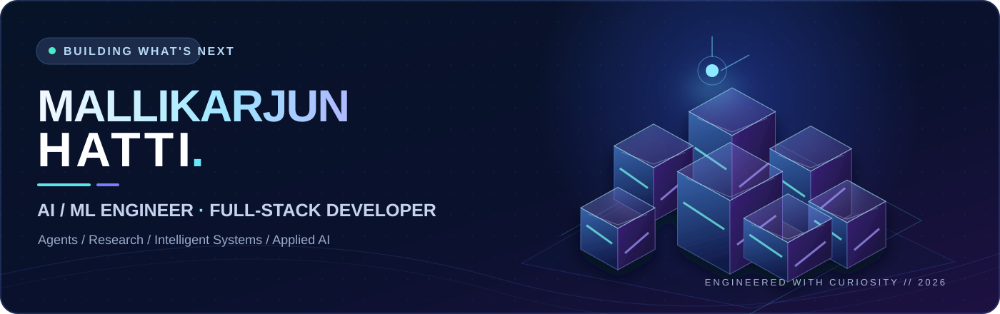
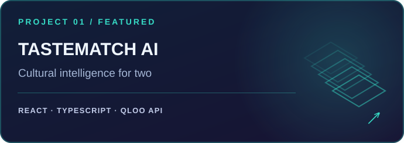
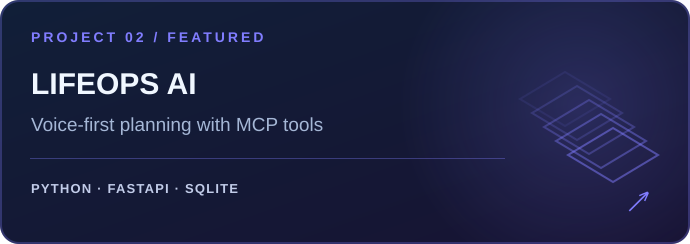
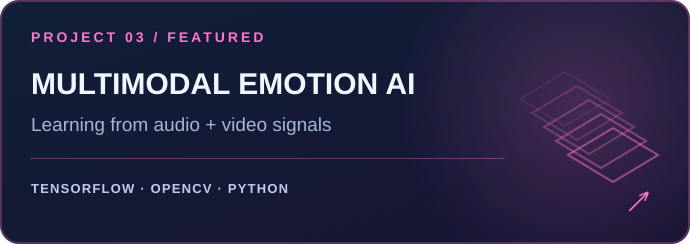
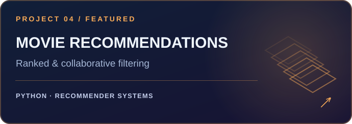
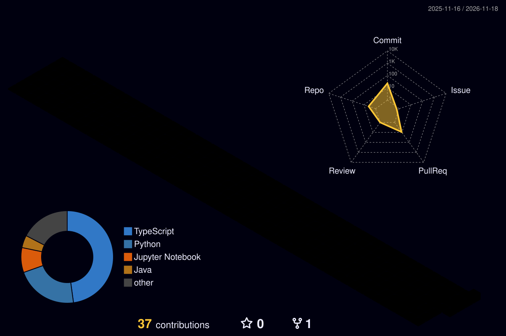

  

   

  
  
  

  
<strong>NYU Tandon · M.S. Computer Science</strong> &nbsp;|&nbsp; <strong>Applied AI Research</strong> &nbsp;|&nbsp; <strong>Full-Stack Systems</strong>

  
<em>I build practical AI systems that connect research, reliable engineering, and real user problems.</em>

---

### ⚡ The short version

- 🎓 Master's student in **Computer Science at NYU Tandon** (expected 2028).
- 🧠 Interested in **trustworthy AI, agents, multimodal learning, recommendation systems, and applied research**.
- 🏗️ Former **Associate Software Engineer at Artha Data Solutions**, working across ML, data engineering, and enterprise workflows (2023–2026).
- 🚀 Built hackathon prototypes spanning **productivity agents, consumer recommendations, DevSecOps, candidate verification, and customer support**.
- 🔬 Leading an ongoing research project, **Enhance AI / HIRS**, exploring contextual response generation, multimodal signals, and mathematical reasoning.

### 🧩 Selected work

<table>
<tr>
<td width="50%"></td>
<td width="50%"></td>
</tr>
<tr>
<td width="50%"></td>
<td width="50%"></td>
</tr>
</table>

**More things I've worked on:** Career Command Center (evidence-grounded job search assistance), DevPilot AI (AI-assisted DevSecOps), ProofHire (candidate verification prototype), and PR-Pulse (pull-request analytics, team collaboration). Some are team, private, or prototype projects and are not linked as public personal repositories here.

### 🛠️ Toolbox

  

 

| Domain | Tools and approaches |
|:--|:--|
| **AI / ML** | PyTorch, TensorFlow, scikit-learn, Hugging Face, NLP, computer vision |
| **Full stack** | Python, React, TypeScript, Node.js, REST APIs, PostgreSQL, FastAPI |
| **Data / infrastructure** | SQL, Apache Kafka, InfluxDB, Talend, Docker, Git, cloud platforms |
| **Agentic applications** | Tool-using assistants, model APIs, workflow design, evaluation and guardrails |

### 🔬 Research and engineering

**Enhance AI — Hybrid Intelligent Research System (HIRS)** · *ongoing research, not a published paper*

A multi-stage architecture combining sarcasm detection, multimodal emotion recognition, mathematical reasoning, and response generation. Reported held-out experimental results: **F1 0.9225** and **AUC-ROC 0.9394**. Research includes ablation studies and error analysis.

**Applied ML and data engineering** · *Artha Data Solutions*

Worked on an industrial digital twin using Kafka and InfluxDB, enterprise data-quality pipelines, and operational analytics. Project results in my resume include approximately **30% less unplanned downtime** in an industrial use case and **25% improved data accuracy** in data-governance workflows.

### 🌌 My GitHub activity in 3D

  
  Automatically refreshed by the included <a href="./.github/workflows/profile-3d.yml">GitHub Action</a> after the first run.

---

  <strong>BUILD · TEST · LEARN · ITERATE</strong>
   
  Making AI more useful, reliable, and grounded in evidence.
    
  

